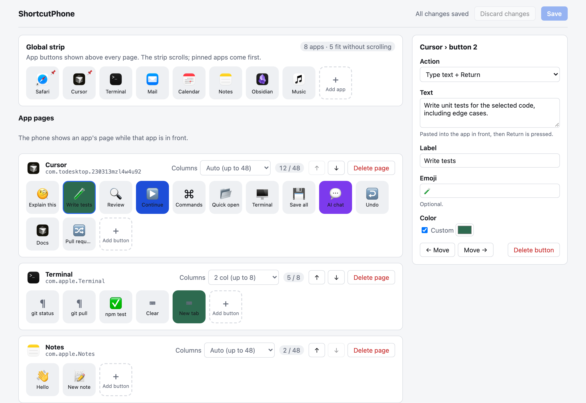
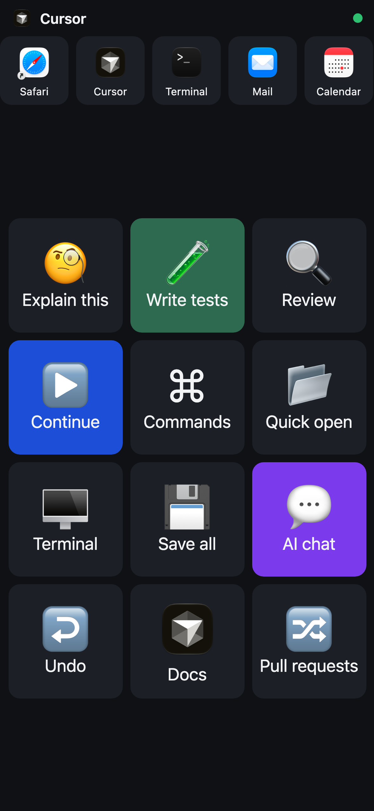

# ShortcutPhone

Turn an old phone into a Stream Deck–style button panel for your Mac.

A small menu-bar app on the Mac serves a touch page to your phone. Tap a button and the Mac
switches apps, types a snippet, presses a key combo, or opens a web page. The phone follows
focus: switch apps on the Mac and the phone shows that app's buttons.

<p align="center">
  
  &nbsp;
  
</p>
<p align="center"><em>Set up buttons in the editor on the Mac (left). The phone shows the page for the app in front (right).</em></p>

- **App buttons** launch an app, or bring it to the front if it's already running.
- **Text buttons** paste a snippet into the focused app and press Return (prompts, replies,
  commands). Your clipboard is restored afterwards.
- **Key buttons** send a shortcut such as `cmd+shift+p`, or a single key such as `1` or `f5`.
- **Web page buttons** open a URL in the page's browser.
- **Pages per app**, plus a strip of app buttons that's always visible.
- **No scrolling.** The grid sizes itself to fit every button on the screen.
- **Edited in your browser**, and phones update as soon as you save.
- **Paired by QR code.** Other devices on your Wi-Fi can't press anything.

Needs macOS 14 or later. The phone side is a web page, so no phone app is needed. It has been
tested on Android with Chrome. Other modern mobile browsers should work over Wi-Fi, but are
untested.

## Install

1. Download `ShortcutPhone-<version>.zip` from
   [Releases](https://github.com/eugenesaz/ShortcutPhone/releases) and unzip it.
2. Move **ShortcutPhone.app** to **Applications**, then open it. If your Mac account isn't an
   administrator, use the **Applications** folder in your home folder (`~/Applications`;
   create it if needed), so updates can install without an admin password.
3. macOS blocks it the first time, because the app isn't notarized by Apple (that needs a paid
   developer account). Open **System Settings › Privacy & Security**, scroll down, click
   **Open Anyway** next to ShortcutPhone, and confirm.

A phone icon appears in the menu bar. ShortcutPhone has no Dock icon or window of its own.

**Updates** install themselves: the app checks once a day, shows what's new, and installs with
one click. The menu also has **Check for Updates…**.

<details>
<summary>Prefer the terminal?</summary>

```sh
xattr -dr com.apple.quarantine /Applications/ShortcutPhone.app
open /Applications/ShortcutPhone.app
```

</details>

## Quick start

1. **Allow Accessibility.** Menu → **Accessibility: not granted — Open Settings…**, then switch
   ShortcutPhone on. Text and key buttons need this to type. App and web page buttons work
   without it.
2. **Pair your phone.** Menu → **Pair Phone…**, then scan the QR code with the phone's camera
   and open the link. The phone and the Mac must be on the same Wi-Fi. If macOS asks whether
   ShortcutPhone may accept incoming network connections, click **Allow**.
3. **Try it.** The first launch installs a starter setup: an app strip (Safari, Notes,
   Terminal, TextEdit) and example pages for Notes and Terminal. Switch to Notes on the Mac and
   tap **Hello** on the phone.
4. **Make it yours.** Menu → **Open Editor…** opens the editor in your browser. Add pages for
   the apps you use, add buttons, and click **Save**.
5. **Optional:** add the page to the phone's home screen (Chrome: ⋮ → **Add to home screen**),
   and turn on **Stay awake** in Android's developer options so the screen stays on while
   charging.

## Buttons

| Type | Does | Notes |
|---|---|---|
| Open app | Launches the app, or brings it to the front | Allowed in the app strip and on pages |
| Text | Pastes the text into the focused app, then presses Return | Page buttons only. Needs Accessibility |
| Keys | Sends a key combo, such as `cmd+shift+p`, `ctrl+alt+t`, `f5` or `1` | Page buttons only. Needs Accessibility |
| Web page | Opens an `http`/`https` URL in the page's app | Page buttons only. Put it on a browser's page |

Text and key buttons run only while their page's app is still in front on the Mac. If focus
moved before the tap arrived, the press is refused and the tile flashes red, so nothing gets
typed into the wrong app.

Keys: letters, digits, `f1`–`f20`, arrows (`left`, `right`, `up`, `down`), `space`, `return`,
`tab`, `esc`, `delete` and punctuation. Modifiers: `cmd`, `shift`, `alt`, `ctrl`.

## Connecting over USB (Android)

Some VPNs send your home network's traffic into their tunnel, so the phone can't reach the Mac
over Wi-Fi while the VPN is on. A USB cable works around this:

1. `brew install --cask android-platform-tools`
2. On the phone, turn on **Developer options** (Settings → About phone → tap **Build number**
   7 times), then turn on **USB debugging**.
3. Plug in the phone and accept **Allow USB debugging?** Within a few seconds the menu shows
   `USB: <phone> — http://localhost:8765`.
4. **Pair Phone…** → **USB**, then scan the QR code.

Over USB the page is `http://localhost`, which Chrome treats as secure, so **Add to home
screen** installs it as a full-screen app.

## Files

Everything lives in `~/Library/Application Support/ShortcutPhone/`:

- `config.json`: your buttons. The editor writes it, and you can also edit it by hand. Changes
  are picked up within a second. If the file becomes invalid, the last good config stays active
  and the menu shows the error.
- `devices.json`: paired phones. Tokens are stored only as SHA-256 hashes.

The server listens on port 8765. Set `"server": {"port": …}` in `config.json` to change it,
then restart the app.

## Security

- The phone UI is plain HTTP on your local network. Every action needs a device token, which
  the phone gets once by scanning a pairing code. Codes expire after 5 minutes and work once.
  Revoke a phone in the editor under **Paired phones**.
- The editor and its API only answer this Mac. They also need a secret key that changes each
  time the app starts, and the menu passes it to the browser. This matters over USB, where the
  phone's traffic arrives as if it were local.
- Someone sniffing your Wi-Fi could see what you tap, but can't press buttons without a token.
  Don't run ShortcutPhone on networks you don't trust.

Found a security problem? Please report it privately through
[GitHub security advisories](https://github.com/eugenesaz/ShortcutPhone/security/advisories/new)
rather than in a public issue.

## Troubleshooting

- **The phone can't open the page.** Check that both are on the same Wi-Fi, and that the macOS
  firewall allows ShortcutPhone (System Settings › Network › Firewall). If a VPN is on, use USB.
- **"Accessibility: not granted" even though the switch is on.** The permission belongs to an
  older build. Remove ShortcutPhone from the Accessibility list with **–**, then grant it again.
- **"This editor link has expired."** The app restarted. Open the editor again from the menu.
- **Text and key buttons flash red.** The app the page belongs to wasn't in front when you
  tapped, or Accessibility isn't granted.

## Building from source

You need Xcode 26 or later (Swift 6.2+) and Node 22.

```sh
npm --prefix web ci
./scripts/make-signing-identity.sh   # once: a local signing identity, so Accessibility survives rebuilds
./scripts/bundle.sh                  # builds build/ShortcutPhone.app
open build/ShortcutPhone.app
./scripts/check.sh                   # lint, typecheck, tests, coverage: run before sending a PR
```

[SPEC.md](SPEC.md) describes the design, the protocol and the security model.
[CONTRIBUTING.md](CONTRIBUTING.md) explains how the code is organized and how to send changes.

## License

[MIT](LICENSE)
